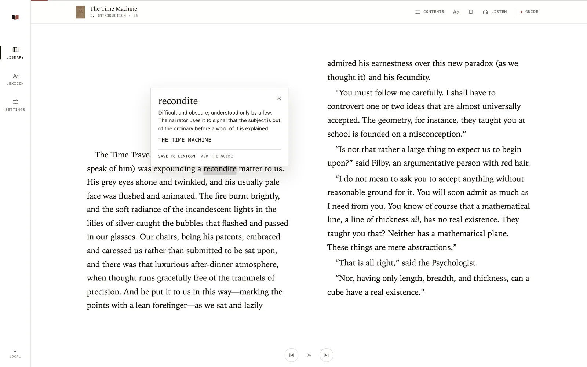

# Book Tutor

Book Tutor is a reading app for EPUB files. It runs fully in your browser. The guide shows what to
notice before you start a chapter. Then it answers questions about the chapter you are in. It also
reads aloud. It keeps a lexicon: a list of saved words with their definitions.

Your books stay on your device. There is no account and no server.

[**Open Book Tutor**](https://bpicori.github.io/book-tutor/)
It runs in any modern browser, and you can install it as an app.

[](https://bpicori.github.io/book-tutor/)

## Try it

1. Open `https://bpicori.github.io/book-tutor/` in a browser.
2. Click **Open the sample book**.
3. Open **Guide**.
4. Click **Generate chapter preview**.

Note: the sample book is *The Time Machine* by H. G. Wells. It is in the public domain. The app
contains written guide answers for its first three chapters. As a result, you can do these steps
without an API key.

## Connect a model

Do these steps to use the guide with your own books.

1. Open **Settings**. Click **The guide**.
2. Select a preset. The preset fills the base URL only.
3. Get a key from the provider.
4. Paste the key in the key field.
5. Click **Load models**. The app fills the three model fields with the first model that it finds.

You can change each model field. The provider supplies the model names.
A chapter preview costs about $0.001 on a small model. A free model costs nothing. A local model
also costs nothing.

## What it does

### A preview before the chapter

The guide reads one chapter only: the chapter in front of you. It returns themes, concepts, tone,
characters, terms, and questions. It does not read the chapters that come after. As a result, it
cannot spoil the book.

A preview is not a summary. A summary tells you what you read. A preview tells you what to notice
next.


### Ask about the chapter you are in

The Ask tab uses the same rule. The guide gets one chapter, plus short summaries of the chapters
that you already previewed. If the answer is not in the chapter, the guide says so.


### A lexicon of your words

Do these steps to save a word.

1. Select the word.
2. Click **Define**.
3. Click **Save to lexicon**.

The lexicon keeps the definition, the book title, and the review state for each word. A word that
you saved on page 40 is available on page 400.




### Read aloud

You can start the read-aloud from any paragraph or chapter. You select the voice in Settings. The
app stores the audio on your device. A chapter that you listened to before does not cost again.

### Library and reader

The app shows the cover, the progress, and the last date for each book. You can filter the library
and search for a title. The reader shows one page or two pages. It keeps your position. You can
change the font, the size, the line height, and the color theme. You can add highlights and notes.

## Read in a language that is not your first

This workflow is the reason for the app. You read the original text, not a translation.

1. Select a word. Click **Define**. If the word is in another language, you get an English gloss.
2. Click **Save to lexicon**. The lexicon keeps the book with the word.
3. Click **Ask**. The guide explains the sentence in simpler words.
4. Click **Listen**. The app reads the paragraph aloud.

It is not a language course. It helps you finish a book that you started.

## Your books, your key, your device

- Books, progress, highlights, notes, the lexicon, and your settings stay in your browser.
- There is no account, no analytics, and no server.
- The app sends data only to the endpoints that you set.
- Your API key stays in the browser. The app sends the key only to your endpoint.
- You can export a full backup, and import it on another device.
- The app works offline after the first load.

CAUTION: Install the app on your home screen, or export a backup. Safari erases site data after
seven days without a visit.

More detail: [privacy](docs/privacy.md), [getting started](docs/getting-started.md),
[FAQ](docs/faq.md).

## Run it yourself

1. Clone the repository with the submodules.

   ```bash
   git clone --recurse-submodules https://github.com/bpicori/book-tutor.git
   cd book-tutor
   ```

2. Install the dependencies.

   ```bash
   npm install
   ```

3. Start the development server.

   ```bash
   npm run dev
   ```

4. Open `http://localhost:5173/book-tutor/` in a browser.

Note: the build is a static site. You can use any static host.

```bash
npm run build     # type-check and build into dist/
npm run preview   # serve the production build
```

The public instance is on GitHub Pages. As a result, the base path is `/book-tutor/`. If you host
the app at the root of a domain, change `base` in `vite.config.ts`.

**Optional sync.** The `cloudflare-worker/` directory contains an endpoint for a backup between
devices. The endpoint is optional. Read [self-hosting](docs/self-hosting.md) for the steps.

## Roadmap

- Export the lexicon to Anki (CSV).
- Add a **Translate** action for a selected passage.
- Add more book formats. The app contains readers for MOBI, AZW3, FB2, and CBZ.
- Highlight the current sentence during the read-aloud.

## Contributing

Read [CONTRIBUTING.md](CONTRIBUTING.md) before you send a pull request. Three rules apply:

- The app must not contain telemetry.
- Do not add a runtime dependency without a reason.
- The guide must not use text from a later chapter.

## License

Book Tutor uses the [GNU Affero General Public License v3.0](LICENSE).

The EPUB renderer is [foliate-js](https://github.com/johnfactotum/foliate-js) by John Factotum.
foliate-js uses the MIT license.

The sample book is *The Time Machine* by H. G. Wells, from
[Project Gutenberg](https://www.gutenberg.org/ebooks/35). It is in the public domain.
