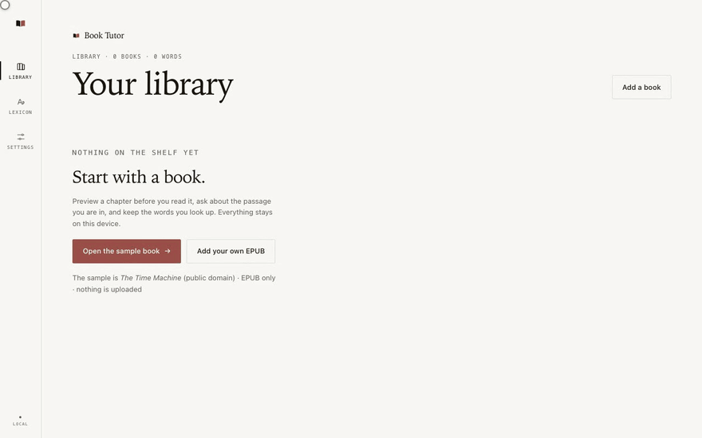
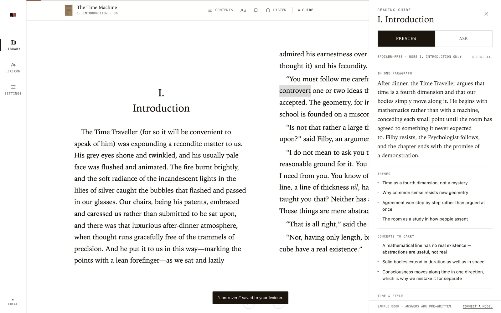
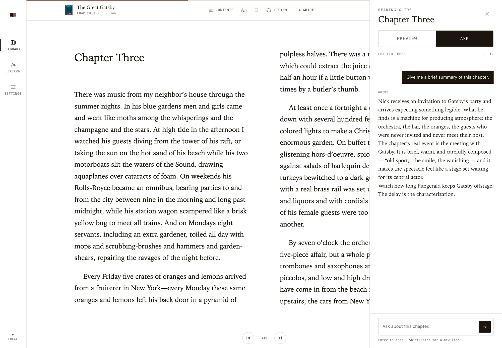
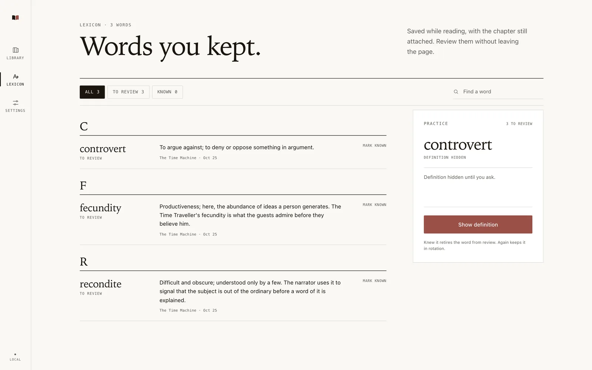

# Book Tutor

**A free, local-first EPUB reader with a reading guide in the margin.** Before you start a
chapter it tells you what to watch for — without spoiling it. While you read, it answers questions
about the chapter you are in. It reads aloud, and it keeps a lexicon of the words you look up.

Your books never leave your device, and there is no account, no server, and no telemetry.

[**Open Book Tutor →**](https://bpicori.github.io/book-tutor/) · Works in any modern browser ·
Installable as an app

[](https://bpicori.github.io/book-tutor/)

## Try it in 30 seconds

1. [Open the app](https://bpicori.github.io/book-tutor/) and press **Open the sample book**.
   *The Time Machine* loads in your browser — no file, no signup, no key.
2. Open **Guide** and press **Generate chapter preview**.
3. To use the guide on your own books, connect a model in **Settings → The guide**. Pick a preset
   (OpenRouter, OpenAI, Groq, Ollama, LM Studio, or any OpenAI-compatible endpoint), paste a key,
   and press **Load models**.

The sample ships with a few written guide responses so you can see the reading experience before
deciding whether to configure a model.

## What it does

### A preview before the chapter, not a summary after it

Most "AI reading" tools recap what you have already read. The guide works the other way: it reads
only the chapter in front of you and returns its themes, the concepts to carry, the tone, the
characters, the terms worth knowing, and a few questions to hold while you read. Nothing from later
chapters is in context, so it cannot spoil what comes next.



### Ask about the chapter you are in

Ask follows the same rule: one chapter plus short summaries of the chapters you have already
previewed. It will explain a passage, untangle a character's motive, or connect an idea to what
came before — and it says so when the answer is not in the text rather than inventing one.



### A lexicon of the words you keep

Select text to highlight it, look it up, or save it to the lexicon. The lexicon keeps each word
with its definition, the book it came from, and whether you know it yet — so a word you had to look
up on page 40 is waiting for you on page 400.



### Read aloud, from anywhere

Paragraph-level text-to-speech from any paragraph or chapter, with a voice you configure. Audio is
cached on your device (LRU, 128 MB) so a chapter you listened to once does not cost anything again.

### And the quiet parts matter too

EPUB rendering with a table of contents, progress, and resumable position · single page or two-page
spread · typography and colour themes · highlights and notes in the sidebar · export/import a full
backup · offline after first load · optional self-hosted sync.

## How it compares

| | Book Tutor | Readest | Koodo Reader | Anx Reader | Kindle "Ask this Book" | Readwise Reader |
| --- | --- | --- | --- | --- | --- | --- |
| Free and open source | **AGPL-3.0** | AGPL-3.0 | AGPL-3.0 | MIT | No | No |
| Runs in the browser, nothing to install | **Yes** | Yes, with an account for sync | Yes | No | No | Yes |
| No account | **Yes** | Sign-in for cloud features | Yes | Yes | Amazon account | Account |
| Your books stay on your device | **Yes** | Optional cloud | Local or self-hosted sync | Yes | Amazon cloud | Cloud |
| Preview *before* you read a chapter | **Yes** | [Not yet](https://github.com/readest/readest/issues/5367) | No | No | Recaps, after the fact | No |
| Questions scoped to the current chapter | **Yes** | Yes, in progress | Prompt-based | Prompt-based | Yes, Kindle books only | Yes |
| Vocabulary page with review | **Yes** | [Not yet](https://github.com/readest/readest/issues/789) | [Not yet](https://github.com/koodo-reader/koodo-reader/issues/1450) | [Not yet](https://github.com/Anxcye/anx-reader/issues/886) | Vocabulary Builder | No |
| Reads aloud | **Yes, your voice** | Yes | Yes | Yes | Yes | Yes |
| Your own model and key | **Yes** | Partial | Yes | Yes | No | No |
| Any EPUB you own | **Yes** | Yes | Yes | Yes | No | Yes |

<sub>Based on the projects' public trackers and documentation, October 2026. Corrections welcome —
open an issue.</sub>

## Read in a language that isn't your first

This is the workflow the app was built around. You read the original, not a translation:

- select a word → **Define** gives you the definition, with an English gloss when the word is in
  another language;
- **Save to lexicon** keeps it with the book it came from;
- **Ask** explains a sentence in your own terms, inside the chapter you are reading;
- **Listen** reads the paragraph aloud while you follow.

It is not a language course. It is the scaffolding that lets you finish a book you would otherwise
put down.

## Your books, your key, your device

- Books, progress, highlights, notes, lexicon, and settings live in your browser's IndexedDB and
  localStorage. There is no backend, no account, and no analytics — you can read the source.
- The only network calls are the ones you configure: your model endpoint for previews, answers, and
  definitions, and your speech endpoint for read-aloud. Your key is stored in this browser and sent
  only to the endpoint you set.
- A chapter preview is a few thousand tokens — roughly $0.001 on a small model. OpenRouter offers
  free models; local models through Ollama or LM Studio cost nothing.
- Safari clears site storage for sites you have not visited in a week. Export a backup from
  **Settings → Data**, or install the app to your home screen.

More detail: [privacy](docs/privacy.md) · [getting started](docs/getting-started.md) ·
[FAQ](docs/faq.md).

## Run it yourself

```bash
git clone --recurse-submodules https://github.com/bpicori/book-tutor.git
cd book-tutor
npm install
npm run dev
```

Then open <http://localhost:5173/book-tutor/> and add an EPUB — or press **Open the sample book**.

```bash
npm run build     # type-check and build into dist/
npm run preview   # serve the production build
```

The build is a static site: any static host works. The public instance is deployed to GitHub Pages
by [`.github/workflows/deploy.yml`](.github/workflows/deploy.yml), which is why `base` is
`/book-tutor/`; change it in [`vite.config.ts`](vite.config.ts) if you host at a domain root.

**Optional sync.** `cloudflare-worker/` contains a small self-hosted endpoint for backing up your
library between devices. It is entirely optional — see
[docs/self-hosting.md](docs/self-hosting.md).

## Roadmap

- [ ] Export the lexicon to Anki (CSV) — the workflow language learners already have
- [ ] A **Translate** action for a selected passage, with a target language setting
- [ ] More formats: the MOBI/AZW3/FB2/CBZ readers are already bundled, the import gate is not
- [ ] Sentence-level read-aloud highlighting

Feature requests are welcome — the [feature request
template](.github/ISSUE_TEMPLATE/feature_request.yml) asks for the reading problem first.

## Contributing

Issues and pull requests are welcome. See [CONTRIBUTING.md](CONTRIBUTING.md) for the development
setup, project layout, and the rules that keep this project what it is (no telemetry, no new
runtime dependencies without a reason, spoiler-free by construction).

## License

[GNU Affero General Public License v3.0](LICENSE). The EPUB rendering engine is
[foliate-js](https://github.com/johnfactotum/foliate-js) by John Factotum (MIT). The sample book is
*The Time Machine* by H. G. Wells, from [Project Gutenberg](https://www.gutenberg.org/ebooks/35),
in the public domain.
